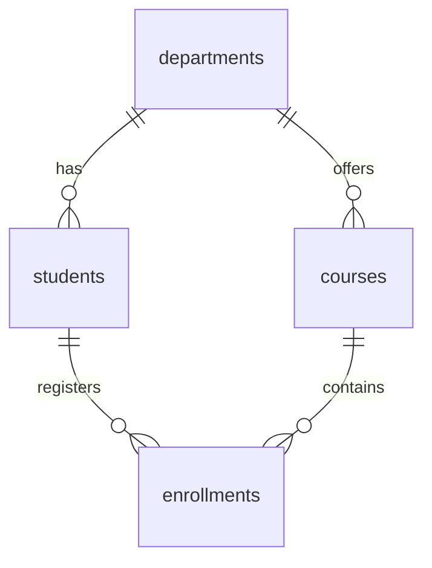

# Full Stack Development (BTCS303P) — Comprehensive Laboratory Repository

**Department of Computer Science & Engineering — COER University, Roorkee**  
**Student Name:** Abhigyan Dubey  
**University Roll No / CU ID:** CU24250059  
**Class Roll No:** 02  
**Branch & Section:** B.Tech CSE "B"  
**Email:** [cu24250059@coeruniversity.ac.in](mailto:cu24250059@coeruniversity.ac.in)  
**Course Code:** BTCS303P — Full Stack Development Laboratory  
**Repository:** [https://github.com/abhigyanDubey/Full_stack_BTCS303P](https://github.com/abhigyanDubey/Full_stack_BTCS303P)

---

## 📑 Lab Sheets Overview

| Lab Sheet | Title | Technology Stack | Location | Status |
| :---: | :--- | :--- | :--- | :---: |
| **Lab 1** | Responsive E-Commerce Storefront | HTML5, Modern CSS3, Flexbox, Grid | Root directory | ✅ Complete |
| **Lab 2** | Dynamic Interactivity & Validation | Vanilla JavaScript (ES6+), LocalStorage | [`script.js`](./script.js) | ✅ Complete |
| **Lab 3** | Component-Driven Architecture & State | React 19, Vite, Hooks (`useState`) | [`otakuverse-react/`](./otakuverse-react/) | ✅ Complete |
| **Lab 4** | Node.js Core Modules & Native Server | Node.js (`fs`, `path`, `os`, `events`, `http`) | [`lab4-nodejs/`](./lab4-nodejs/) | ✅ Complete |
| **Lab 5** | Express.js Web Framework & REST APIs | Express.js, Router, Middleware, CRUD | [`lab5-express/`](./lab5-express/) | ✅ Complete |
| **Lab 6** | Full-Stack REST API & Security | Node.js, Express, CORS, Auth, React Client | [`lab6-apis/`](./lab6-apis/) | ✅ Complete |
| **Lab 7** | Relational Database & SQL Solutions | MariaDB / MySQL 8.0, DDL, DML, Joins, ACID | [`lab7-sql/`](./lab7-sql/) | ✅ Complete |

---

## 📅 Implementation Timeline & Lab Sheet Work Logs

### 🔹 Lab Sheet 1: Building the Storefront (HTML5 & CSS3)
- **Status:** Completed  
- **Objective:** Design and construct a multi-page, visually immersive, responsive e-commerce web interface using semantic HTML5 and modern CSS3 layout techniques.
- **Deliverables & HTML Files:**
  1. [`index.html`](./index.html) — Storefront homepage, hero section banner with call-to-action buttons, store features showcase, and featured collectibles.
  2. [`products.html`](./products.html) — Full catalog browsing page with interactive category filter bar.
  3. [`product-detail.html`](./product-detail.html) — Single product view featuring a thumbnail image gallery switcher, technical specifications table, and quantity adjuster.
  4. [`cart.html`](./cart.html) — Tabular shopping cart layout displaying item thumbnails, unit pricing, quantity fields, subtotal, and summary card.
  5. [`checkout.html`](./checkout.html) — Multi-section order finalization page with shipping address inputs and payment method selector.
- **Styling Architecture (`style.css`):**
  - **CSS Custom Properties (`:root`):** Cyberpunk dark palette featuring Sakura Pink (`#ff2a74`), Cyber Cyan (`#00f0ff`), Spirit Violet (`#9d4edd`), and glassmorphism translucent panels.
  - **Layout Models:** **Flexbox** for navbar headers, footers, and cards; **CSS Grid** for responsive product grids (`repeat(auto-fill, minmax(260px, 1fr))`) and cart layouts.
  - **Visual FX & Responsiveness:** Glassmorphism (`backdrop-filter: blur(12px)`), neon glow hover states, and `@media` queries supporting mobile, tablet, and desktop viewports.
- **Background FX (`particles.js`):**
  - HTML5 2D Canvas ambient animation with floating sakura petals and glowing energy particles.

---

### 🔹 Lab Sheet 2: Making It Interactive (Vanilla JavaScript)
- **Status:** Completed  
- **Objective:** Add cart logic, dynamic rendering, and form validation using plain JavaScript (Vanilla JS) before migrating to React.  
- **Main Script File:** [`script.js`](./script.js) (Linked across all HTML pages)

#### Detailed Task Breakdown:
1. **Task 1: Catalog Data Array (`products`)** — 19 structured items with pricing, category badges, and image links.
2. **Task 2: Dynamic Product Rendering** — Programmatic DOM generation replacing hardcoded HTML.
3. **Task 3: 'Add to Cart' Click Handler & Storage Persistence** — `localStorage.setItem()` synchronization.
4. **Task 4: Dynamic Cart Rendering** — Tabular cart generation with thumbnail previews, quantities, and remove buttons.
5. **Task 5: Explicit `calculateTotal()` Function** — Utilizes `Array.prototype.reduce()` for realtime subtotal and grand total calculation.
6. **Task 6: Checkout Form Validation** — Real-time regex validation (6-digit pincode, 10-digit phone number) and inline error spans.
7. **Task 7: Order Confirmation & Cart Reset** — Dynamic order ID generation and storage flushing.
8. **Task 8: Universal Navbar Cart Badge Sync** — Live badge updates synchronized on `DOMContentLoaded`.

---

### 🔹 Lab Sheet 3: Rebuilding with React (Components, Props, useState)
- **Status:** Completed  
- **Objective:** Convert the product listing and cart into a modular React application using components, props, and state (`useState`).  
- **Directory:** [`otakuverse-react/`](./otakuverse-react/) (Built with React 19 + Vite)

#### Key Architectural Highlights:
- **Components & Unidirectional Flow:** Parent-to-child data flow via props across `Navbar`, `Hero`, `ProductList`, `ProductCard`, `Cart`, and `CheckoutForm`.
- **State Management (`useState`):** Centralized cart state in `App.jsx`, item quantity adjustments, and modal triggers.
- **Strict Unique Keys:** Consistent assignment of persistent IDs (`product.id`) preventing unnecessary virtual DOM re-renders.
- **Responsive Layout:** CSS Grid auto-fit grid, card hover transitions, and mobile media queries.

---

### 🔹 Lab Sheet 4: Node.js Core Modules & Native HTTP Server
- **Status:** Completed  
- **Objective:** Master built-in Node.js runtime APIs, asynchronous file I/O, event emitters, stream processing, and native HTTP servers without external frameworks.  
- **Directory:** [`lab4-nodejs/`](./lab4-nodejs/)

#### Task Implementations:
1. **Task 1 (`sum.js`, `even-odd.js`, `app1.js`):** CommonJS custom module creation and consumption via `require()`.
2. **Task 2 (`file-ops.js`):** Asynchronous file manipulation chain using `fs.writeFile`, `fs.appendFile`, `fs.readFile`, and `fs.rename`.
3. **Task 3 (`dir-ops.js`):** Directory lifecycle management using `fs.mkdir({ recursive: true })`, `fs.readdir`, and `fs.unlink`.
4. **Task 4 (`path-demo.js`):** Path normalization and extraction with `path.dirname`, `path.basename`, `path.extname`, and `path.resolve`.
5. **Task 5 (`sys-report.js`):** Machine diagnostic reporting using `os.platform()`, `os.arch()`, `os.totalmem()`, `os.freemem()`, `os.cpus()`, and `os.uptime()`.
6. **Task 6 (`order-events.js`):** Event-driven decoupled architecture using Node.js `EventEmitter`.
7. **Task 7 & 8 (`server.js`):** Native HTTP server using `http.createServer` and `url.parse` handling routing (`/`, `/students`, `/students/:id`, `/search`), query parsing, status codes (404, 405), and JSON responses.
8. **Task 9 (`stream-demo.js`):** High-efficiency data processing using `fs.createReadStream` listening to `data` and `end` events.
9. **Task 10 (`id-gen.js`):** Third-party dependency integration utilizing `nanoid`.
10. **Task 11 (`calc-cli.js`):** CLI application consuming `process.argv` with arithmetic operators and edge-case handling.
11. **Task 12 (`env-demo.js`):** Environment configuration using `process.env.PORT`.

---

### 🔹 Lab Sheet 5: Express.js Routing, Middleware, REST APIs & Error Handling
- **Status:** Completed  
- **Objective:** Build robust backend services with Express.js including routing patterns, custom middlewares, input parsers, and centralized error handling.  
- **Directory:** [`lab5-express/`](./lab5-express/)

#### Core Concepts Implemented:
- **Project Configuration (`index.js`):** Express runtime powered by `dotenv` for environment management.
- **Middleware Pipeline:**
  - Global request logger capturing method, URL, and timestamps.
  - Header-based route guard (`adminAuth`) protecting `/admin/dashboard` requiring `x-api-key`.
  - Body parsers: `express.json()` and `express.urlencoded({ extended: true })`.
- **Modular Routers (`express.Router()`):**
  - `routes/students.js` (`/api/students`, `/api/students/:id`)
  - `routes/books.js` (`/api/books`, `/api/books/:id`)
  - `routes/resource.js` (`/api/tasks` full REST CRUD: GET, POST, PUT, DELETE)
- **Static Assets:** Hosted static web content via `express.static(path.join(__dirname, "public"))`.
- **Error Handling Architecture:**
  - Standard 404 Route Not Found middleware.
  - Centralized 4-parameter error handler `(err, req, res, next)` returning standardized error payloads.

---

### 🔹 Lab Sheet 6: Full Backend Integration — APIs (Practical)
- **Status:** Completed  
- **Objective:** Construct a complete Node.js + Express REST API from scratch, enforce security with CORS and API keys, and consume it end-to-end with both Plain JavaScript and React clients.  
- **Directory:** [`lab6-apis/`](./lab6-apis/)

#### Architecture & Highlights:
- **Secure Backend API (`backend/server.js`):**
  - Full CRUD task operations (`/api/tasks`).
  - Write operations guarded by `authMiddleware` enforcing valid `x-api-key` header.
  - Cross-Origin Resource Sharing (`cors`) enabled for multi-client consumption.
  - Centralized error trapping and consistent status codes (200, 201, 400, 401, 404, 500).
- **Plain JavaScript Client (`client-vanilla/`):**
  - Standalone `index.html` + `script.js` communicating via async `fetch()`.
  - Handles loading states, network failures, and dynamic list rendering.
- **React Client Component (`client-react/TaskManager.jsx`):**
  - Controlled forms with `useState` and `useEffect`.
  - Task creation with `POST` mutation and `x-api-key`.
  - Task deletion with `DELETE` mutation.
  - Built-in "Test 404" and "Reload with Axios" triggers for testing error handling.

---

### 🔹 Lab Sheet 7: Fullstack Relational Database (SQL) Solutions
- **Status:** Completed  
- **Objective:** Comprehensive mastery of relational databases using MariaDB / MySQL covering schema definition, data manipulation, aggregation, multi-table joins, subqueries, indexing, views, and ACID transactions.  
- **Directory:** [`lab7-sql/`](./lab7-sql/)

#### Schema & Topics Covered:


- **Database Setup & Schema:** `departments`, `students`, `courses`, and `enrollments` with CHECK constraints (`age >= 17`) and foreign keys.
- **Part A (DDL):** `CREATE TABLE`, `ALTER TABLE` (ADD, RENAME, DROP column), `DROP TABLE`, and in-depth analysis of `DROP` vs `TRUNCATE` vs `DELETE`.
- **Part B (DML):** `INSERT`, default/null handling, arithmetic `UPDATE`, `DELETE`, and CHECK constraint rejection verification.
- **Part C (Querying with SELECT):** Filtering with `BETWEEN`, `IN`, `LIKE`, `IS NULL`, `DISTINCT`, multi-key sorting, and pagination via `LIMIT`.
- **Part D (Functions & Aggregation):** `COUNT`, `AVG`, `MIN`, `MAX`, `GROUP BY`, `HAVING`, string functions, and execution order analysis (`WHERE` vs `HAVING`).
- **Part E (Joins):** `INNER JOIN`, `LEFT JOIN` (identifying NULLs), `RIGHT JOIN`, 3-table join (`students`-`enrollments`-`courses`), and un-enrolled records discovery.
- **Part F (Subqueries):** Scalar subqueries, multi-row lookups (`IN`, `EXISTS`), and correlated subqueries comparing student marks against course averages.
- **Part G (Indexes, Views & Transactions):** Index creation, query plan analysis via `EXPLAIN`, virtual views (`student_marks`), and transactional integrity demonstrating `ROLLBACK` vs `COMMIT`.
- **Part H (Challenge Problems):** Analytic window functions (`RANK()`, `DENSE_RANK()`), `CASE` conditional grading, Self Joins for peer matching, and second-highest score retrieval without `LIMIT`.

---

## 📂 Project Directory Structure

```
Full_stack_BTCS303P/
├── README.md                      <-- Comprehensive Coursework Documentation
├── Full_stack_labsheet/           <-- Official Lab Sheet Submission PDFs
│   ├── BTCS303P-AS01-Answer_compressed.pdf
│   ├── BTCS303P-AS02-Answer.pdf
│   ├── Full stact_Lab3-Answer.pdf
│   ├── Labsheet 4 _Abhigyan_DUbey_FSL.pdf
│   ├── Full Stack lab sheet 5_AbhigyanDubey.pdf
│   ├── LabSheet-6 Full Stack.pdf
│   └── Labsheet 7_Solution_Abhigyan_Dubey.pdf
│
├── index.html                     <-- Lab 1 & 2: HTML5 Storefront Homepage
├── products.html                  <-- Lab 1 & 2: Dynamic Catalog Page
├── product-detail.html            <-- Lab 1 & 2: Single Product View
├── cart.html                      <-- Lab 1 & 2: Tabular Shopping Cart
├── checkout.html                  <-- Lab 1 & 2: Checkout & Validation
├── style.css                      <-- Lab 1 & 2: Cyberpunk Stylesheet
├── script.js                      <-- Lab 2: Vanilla JavaScript Logic
├── particles.js                   <-- Canvas Particle FX
│
├── otakuverse-react/              <-- 🚀 Lab Sheet 3: React 19 + Vite Application
│   ├── package.json
│   ├── src/
│   │   ├── App.jsx                <-- State Hub & Cart Management
│   │   ├── components/            <-- Modular UI Components
│   │   └── data/products.js       <-- Product Catalog Data Source
│
├── lab4-nodejs/                   <-- 🚀 Lab Sheet 4: Node.js Core Modules
│   ├── package.json
│   ├── app1.js / sum.js / even-odd.js  <-- Task 1: Custom Modules
│   ├── file-ops.js                <-- Task 2: File System Operations
│   ├── dir-ops.js                 <-- Task 3: Directory Operations
│   ├── path-demo.js               <-- Task 4: Path Module
│   ├── sys-report.js              <-- Task 5: OS Diagnostics
│   ├── order-events.js            <-- Task 6: EventEmitter
│   ├── server.js                  <-- Task 7-8: Native HTTP Server
│   ├── stream-demo.js             <-- Task 9: Readable Streams
│   ├── id-gen.js                  <-- Task 10: Nanoid Integration
│   ├── calc-cli.js                <-- Task 11: CLI Arguments
│   ├── env-demo.js                <-- Task 12: Environment Config
│   └── README.md
│
├── lab5-express/                  <-- 🚀 Lab Sheet 5: Express.js Framework
│   ├── package.json
│   ├── .env
│   ├── index.js                   <-- Express Server & Middleware
│   ├── routes/
│   │   ├── students.js            <-- Student Modular Router
│   │   ├── books.js               <-- Books Modular Router
│   │   └── resource.js            <-- CRUD Task REST API
│   ├── public/index.html          <-- Static File Asset
│   └── README.md
│
├── lab6-apis/                     <-- 🚀 Lab Sheet 6: Full Backend Integration
│   ├── backend/
│   │   ├── package.json
│   │   ├── .env
│   │   └── server.js              <-- Express REST API with Auth & CORS
│   ├── client-vanilla/
│   │   ├── index.html             <-- Plain JS Frontend Client
│   │   └── script.js
│   ├── client-react/
│   │   └── TaskManager.jsx        <-- React Component Client
│   └── README.md
│
└── lab7-sql/                      <-- 🚀 Lab Sheet 7: SQL Database Solutions
    ├── schema_and_seed.sql        <-- Database Creation & Seed Data
    ├── 01_ddl_solutions.sql       <-- Part A: DDL Operations
    ├── 02_dml_solutions.sql       <-- Part B: DML Operations
    ├── 03_select_queries.sql      <-- Part C: Querying with SELECT
    ├── 04_aggregation_functions.sql <-- Part D: Functions & Aggregation
    ├── 05_joins.sql               <-- Part E: Relational Joins
    ├── 06_subqueries.sql          <-- Part F: Subqueries
    ├── 07_indexes_views_transactions.sql <-- Part G: Index, View & ACID
    ├── 08_challenge_problems.sql  <-- Part H: Window Functions & Grading
    ├── college_db_full.sql        <-- Consolidated Runnable Script
    └── README.md
```

---

## 🚀 How to Run Locally

### 1. Static Storefront (Lab 1 & 2 - HTML5/CSS3/Vanilla JS)
Open [`index.html`](./index.html) in any web browser or serve with Live Server.

### 2. React Storefront (Lab Sheet 3 - React + Vite)
```bash
cd otakuverse-react
npm install
npm run dev
# Running at http://localhost:5173
```

### 3. Node.js Core Modules (Lab Sheet 4)
```bash
cd lab4-nodejs
npm install
node app1.js
node calc-cli.js 10 5 +
node server.js
```

### 4. Express.js REST Server (Lab Sheet 5)
```bash
cd lab5-express
npm install
npm run dev
# Running at http://localhost:4000
```

### 5. API Integration & Clients (Lab Sheet 6)
```bash
# Start backend server
cd lab6-apis/backend
npm install
npm run dev
# Backend running at http://localhost:5000

# Open plain JS client
# Launch lab6-apis/client-vanilla/index.html in browser
```

### 6. SQL Database Solutions (Lab Sheet 7)
```bash
mysql -u root -p < lab7-sql/college_db_full.sql
```

---

## 👤 Author Information

- **Name:** Abhigyan Dubey
- **University:** COER University, Roorkee
- **Department:** Department of Computer Science & Engineering
- **CU ID:** CU24250059
- **Roll No:** 02 (B.Tech CSE "B")
- **Email:** [cu24250059@coeruniversity.ac.in](mailto:cu24250059@coeruniversity.ac.in)
- **GitHub Repository:** [https://github.com/abhigyanDubey/Full_stack_BTCS303P](https://github.com/abhigyanDubey/Full_stack_BTCS303P)
