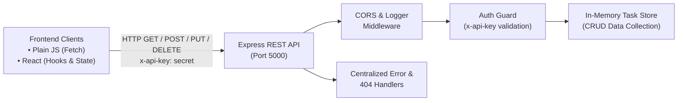

# Lab Sheet 6 — APIs (Practical)

**Student Name:** Abhigyan Dubey  
**Roll No:** 02  
**CU ID:** CU24250059  
**Branch:** B.Tech CSE "B"  
**Course:** Full Stack Web Development (BTCS303P)  

---

## 📌 Objective

Build a complete Node.js + Express REST API from scratch, secure and test it, then consume it from both a plain JavaScript client and a React client — covering the full backend-to-frontend pipeline, without a database.

---

## 🏛️ System Architecture



---

## 📂 Implementation Details

### Q1: Server Setup & Building the REST API (`backend/server.js`)
- Express server configured with CORS (`cors`), body parsers (`express.json()`, `express.urlencoded()`), and environment variables (`dotenv`).
- **Global Logger Middleware:** Logs request method, original URL, and ISO timestamp.
- **Header-Based Authentication Middleware (`authMiddleware`):**
  - Requires `x-api-key` header matching `API_KEY` for mutating routes (`POST`, `PUT`, `DELETE`).
  - Returns `401 Unauthorized` with `{ error: "Unauthorized", message: "Valid x-api-key header is required" }` if absent or invalid.
- **REST Endpoints (`/api/tasks`):**
  - `GET /api/tasks` — Fetch full task list.
  - `GET /api/tasks/:id` — Fetch task by ID (returns 404 if not found).
  - `POST /api/tasks` — Validates non-empty title, generates auto-incrementing ID, appends task, returns status `201 Created`.
  - `PUT /api/tasks/:id` — Modifies task title and/or boolean status.
  - `DELETE /api/tasks/:id` — Removes task from collection and confirms deletion.
- **Error Handlers:**
  - 404 Route Not Found middleware catching invalid endpoints.
  - Centralized 4-parameter error handler `(err, req, res, next)` formatting errors consistently.

### Q2: Securing, Testing & Error-Handling the API
- Evaluates Cross-Origin Resource Sharing (CORS) prevention vs enablement.
- Validates request payloads with HTTP testing clients (Postman / Thunder Client).

### Q3: Plain JavaScript Client (`client-vanilla/`)
- Pure HTML5 + ES6 JavaScript interface consuming `http://localhost:5000/api/tasks`.
- Asynchronous data fetching via `fetch()` with `async/await`.
- Dynamic DOM manipulation updating loading indicators, error boxes, and task lists.

### Q4 & Q5: React Client & Error Handling (`client-react/`)
- Controlled React component `TaskManager.jsx` managing state with `useState` and `useEffect`.
- Interactive Add Task form with `POST` mutation and `x-api-key` header.
- Inline task deletion with `DELETE` mutation.
- Dedicated "Test 404" trigger for verifying client-side network error trapping.

---

## 🚀 How to Run

### 1. Start Backend API Server
```bash
cd lab6-apis/backend
npm install
npm run dev
# Server running at http://localhost:5000
```

### 2. Launch Plain JavaScript Client
Open `lab6-apis/client-vanilla/index.html` directly in your browser or with Live Server.

### 3. React Client Component
Import `<TaskManager />` from `lab6-apis/client-react/TaskManager.jsx` into any React application.
