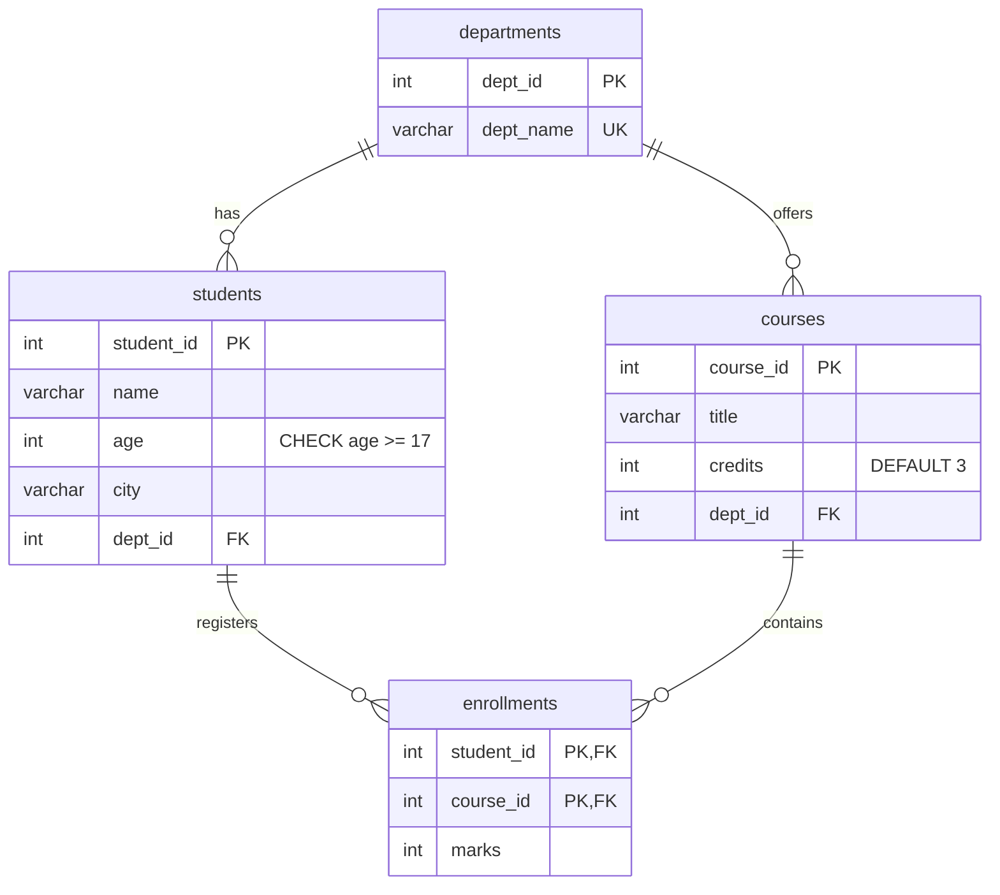

# Lab Sheet 7 — Fullstack SQL Solutions

**Student Name:** Abhigyan Dubey  
**Roll No:** 02  
**CU ID:** CU24250059  
**Branch:** B.Tech CSE "B"  
**Course:** Full Stack Web Development (BTCS303P)  
**Database Engine:** MariaDB 10.11 / MySQL 8.0 Compatible  

---

## 📌 Overview

This lab provides hands-on mastery of relational database design, data manipulation, aggregation, multi-table joins, subqueries, database indexing, virtual views, transaction isolation with ACID guarantees, and advanced analytic SQL window functions.

---

## 🗄️ Relational Schema Diagram



---

## 📂 Query Breakdown & Solution Reference

| File | Section | Concepts Covered |
| :--- | :--- | :--- |
| [`schema_and_seed.sql`](./schema_and_seed.sql) | **Setup** | DDL for 4 core tables, CHECK constraints, foreign keys, and seed dataset. |
| [`01_ddl_solutions.sql`](./01_ddl_solutions.sql) | **Part A** | Table creation, `ALTER TABLE` ADD/RENAME/DROP column, `DROP TABLE`, DROP vs TRUNCATE vs DELETE analysis. |
| [`02_dml_solutions.sql`](./02_dml_solutions.sql) | **Part B** | `INSERT`, default handling, `UPDATE` arithmetic, `DELETE`, CHECK constraint enforcement (`age >= 17`). |
| [`03_select_queries.sql`](./03_select_queries.sql) | **Part C** | Basic filtering, `BETWEEN`, `IN`, `LIKE`, `IS NULL`, `DISTINCT`, multi-column `ORDER BY`, `LIMIT`, and column aliases. |
| [`04_aggregation_functions.sql`](./04_aggregation_functions.sql) | **Part D** | `COUNT()`, `AVG()`, `MIN()`, `MAX()`, `GROUP BY`, `HAVING` vs `WHERE` execution semantics, `COALESCE()`. |
| [`05_joins.sql`](./05_joins.sql) | **Part E** | `INNER JOIN`, `LEFT JOIN`, `RIGHT JOIN`, 3-table join (`students`-`enrollments`-`courses`), identifying unmatched rows (`IS NULL`). |
| [`06_subqueries.sql`](./06_subqueries.sql) | **Part F** | Scalar subqueries, multi-row subqueries with `IN` and `EXISTS`, correlated subqueries comparing student marks against course averages. |
| [`07_indexes_views_transactions.sql`](./07_indexes_views_transactions.sql) | **Part G** | `CREATE INDEX` + `EXPLAIN` query execution plan, `CREATE VIEW`, `START TRANSACTION`, `ROLLBACK` vs `COMMIT`. |
| [`08_challenge_problems.sql`](./08_challenge_problems.sql) | **Part H** | Window functions (`RANK()`, `DENSE_RANK()`), `CASE` conditional expressions, Self Joins, 2nd-highest marks calculation without `LIMIT`. |
| [`college_db_full.sql`](./college_db_full.sql) | **Full Script** | Complete runnable SQL file containing all schema definitions, seed data, and verified queries. |

---

## 💡 Key Architectural Concepts

### 1. `DROP` vs `TRUNCATE` vs `DELETE`
- **`DROP` (DDL):** Destroys the table schema, constraints, indexes, triggers, and all rows. Irreversible and cannot be rolled back.
- **`TRUNCATE` (DDL):** Flushes all rows by deallocating data pages. Very fast, resets `AUTO_INCREMENT`, cannot take `WHERE`, causes an implicit commit.
- **`DELETE` (DML):** Deletes rows individually (firing triggers and logging undo transactions). Allows conditional `WHERE` filters and can be rolled back inside transactions.

### 2. `WHERE` vs `HAVING`
- **`WHERE`:** Filters rows *before* aggregation. Aggregates like `COUNT(*)` or `AVG()` cannot be used here because groups have not been formed.
- **`HAVING`:** Filters grouped results *after* `GROUP BY` using aggregate expressions.

### 3. ACID Transactions (`COMMIT` vs `ROLLBACK`)
- `ROLLBACK` returns all uncommitted row modifications back to the state preceding `START TRANSACTION`.
- `COMMIT` flushes dirty buffer pages and write-ahead logs to disk, permanently applying changes across all sessions.

---

## 🚀 How to Execute

Using the MySQL / MariaDB command line or GUI client (DBeaver, phpMyAdmin, MySQL Workbench):

```bash
# Log in to MariaDB / MySQL
mysql -u root -p

# Execute full solution script
source /path/to/Full_stack_Assignment_1/lab7-sql/college_db_full.sql;
```
